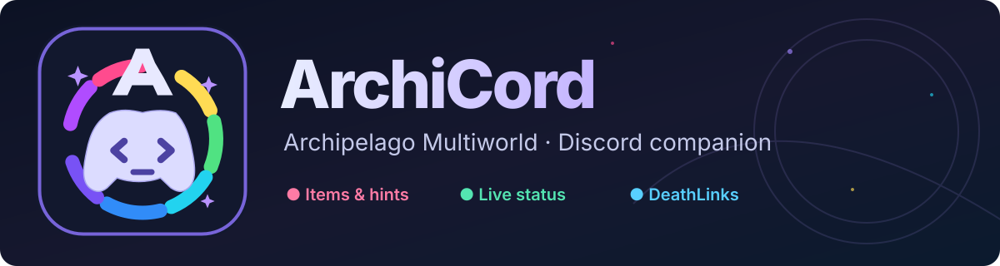

<div align="center">



# ArchiCord 🎮

**A Discord companion for Archipelago Multiworld sessions.**

[](https://www.python.org/)
[](https://github.com/Mykah94/ArchiCord/actions/workflows/archicord-ci.yml)


**[Getting started](#-getting-started) · [Features](#-features) · [Tracker setup](#-universal-tracker-optional) · [Documentation](#-documentation)**

</div>

ArchiCord connects to an [Archipelago](https://archipelago.gg/) multiworld and publishes the information your players need in Discord: item and trap notifications, hint boards, goals, online status, DeathLink rankings and optional logic-backed progress tracking. A **local Web UI** handles bot controls and configuration.

This is an independent community project, not an official Discord or Archipelago product.

## ✨ Features

| Feature | What it does |
| --- | --- |
| 🎯 **Doable checks** | Shows reachable, incomplete locations **only when a compatible Universal Tracker provides confirmed logic results** |
| 🧩 **Universal Tracker** | Runs the optional local CLI per selected player and maps known location names to Archipelago IDs |
| 🌍 **APWorld selection** | Scans local world manifests without executing their Python code and selects the games to track |
| 👥 **Player status** | Online/offline player board with game assignments |
| 🔎 **Hints** | Hint announcements and a persistent open/found hint board |
| 🎁 **Items & traps** | Colored Discord embeds for observed progression items and traps |
| ☠️ **DeathLinks** | Per-seed death leaderboard and a special message every **25 deaths per player** |
| 🏆 **Goals** | Goal announcements and completion counters |
| 📣 **Feature announcement** | Configurable once-per-seed feature embed, plus `/archi funktionen` |
| 🌐 **Local Web UI** | Start, stop and restart the bot, edit `.env`, inspect connection status and logs |
| 💾 **Seed persistence** | JSON state separated by server, seed, team and bot slot |

Progression-item and trap counters are **not** shown as part of the live doable-check overview; their events are handled separately.

## 🖥️ Local control panel

<div align="center">


</div>

The Web UI runs at **http://127.0.0.1:8765/** and the APWorld selection page at **http://127.0.0.1:8765/apworlds**.

The branding above and the Web UI background are **new replacement illustrations**, not recovered copies of the previous missing artwork. The HTML/CSS/JavaScript layout and controls remain in place.

> 🔒 **Local only.** Do not forward the Web UI port to the internet or put it behind a public reverse proxy. Tokens and passwords are intentionally hidden from the status API. Leaving a password/token field blank keeps the saved value.

## 🚀 Getting started

**Requirements:** Python **3.11 or 3.13**, a Discord bot/application, and access to an Archipelago server. Python 3.15 is not currently part of the supported CI matrix.

1. Clone or download the repository:

   ```bash
   git clone https://github.com/Mykah94/ArchiCord.git
   cd ArchiCord
   ```

2. Install dependencies:

   ```bash
   python -m pip install -r requirements.txt
   ```

3. Copy `.env.example` to **`.env`** and configure `DISCORD_TOKEN`, `AP_URL`, `AP_SLOT`, `AP_GAME`, and your Discord channel IDs. Never publish `.env`.

   Windows PowerShell:

   ```powershell
   Copy-Item .env.example .env
   ```

4. Launch the control panel: run **`START_WEBUI.bat`** on Windows, or **`sh start_webui.sh`** on Linux/macOS.
5. Open **http://127.0.0.1:8765/**, start the bot, and verify both Discord and Archipelago connections in the live log.

**Upgrading an existing installation?** Back up the entire folder first, especially `.env`, `archicord_data/`, `deathlinks/`, player YAMLs and tracker files. Do **not** overwrite or commit private state.

## 🧩 Universal Tracker (optional)

Without Universal Tracker, the bot remains usable, but reports **no logic data** rather than guessing what checks are possible.

1. Install a compatible local Archipelago distribution, Universal Tracker, player YAMLs and the necessary `.apworld` versions.
2. Set the launcher in `.env` (example Windows path):

   ```dotenv
   ARCHICORD_UT_LAUNCHER=C:\ProgramData\Archipelago\ArchipelagoLauncherDebug.exe
   ARCHICORD_UT_INTERVAL=120
   ARCHICORD_CHECKS_FILE=tracker/exports/live_checks.json
   ```

3. Visit **http://127.0.0.1:8765/apworlds** and select the games to track.
4. Start the bot and check messages prefixed **`[UT]`**. The first polling attempt follows receipt of the Archipelago data package; subsequent checks run on an interval.

The APWorld selection controls **ArchiCord's tracker queries**. It does not control which worlds the separate Archipelago launcher loads. Compatibility depends on the individual game's YAML, APWorld and tracker versions.

See [Universal Tracker setup](docs/UNIVERSAL_TRACKER.md) for limitations and diagnostics.

## 💬 Slash commands

| Command | Purpose |
| --- | --- |
| `/archi status` | Player online/offline status |
| `/archi hints` | Open/found hints, with filtering and pages |
| `/archi deaths` | DeathLink leaderboard |
| `/archi fortschritt` | Player progress |
| `/archi statistik` | Seed and player statistics |
| `/archi funktionen` | Feature overview |

Discord permissions: **View Channels**, **Send Messages**, **Embed Links**, **Read Message History** and **Use Application Commands**. Invite with the **`bot`** and **`applications.commands`** scopes. No privileged Gateway intents are required.

## 📚 Resources & release announcements

The Web UI now includes a **Resources** tab at **http://127.0.0.1:8765/resources**, linking to the [official Archipelago website](https://archipelago.gg/) and the [official software release downloads](https://github.com/ArchipelagoMW/Archipelago/releases/latest).

ArchiCord can announce **new stable releases of the official Archipelago application** in a Discord channel. In the Web UI's Bot Control settings, enter the numeric channel ID for `ARCHIPELAGO_RELEASE_CHANNEL_ID`, save, and **restart the bot**. ArchiCord checks GitHub about every six hours while running (`ARCHIPELAGO_RELEASE_CHECK_INTERVAL`, minimum one hour).

On first use, ArchiCord stores the current release as a baseline **without posting an old version**. Later stable releases are announced once per channel and remain recorded across bot restarts and seed changes. Failed sends will be retried. This does not check for individual APWorld updates or install software automatically. Internet access to GitHub and Discord message permissions are required.

## 🌈 ArchiCord 3.0 — Multiworld Control Center

The optional new dashboard adds **ten views** while keeping the original Bot Control, APWorld Manager and Resources pages:

| View | What it shows |
| --- | --- |
| 📊 [Dashboard](http://127.0.0.1:8765/dashboard) | Seed summary, player status, goals, DeathLinks and checks |
| 👥 Players | Per-player online status, games and confirmed doable counts |
| 🎯 Checks | Search and filter completed, missing and tracker-confirmed doable locations by player |
| 🕘 History | Saved multiworld sessions and per-seed summaries |
| 🎁 Item Routes | Newly recorded sender → receiver item and trap events |
| 💚 Health | Discord, Archipelago, Universal Tracker and snapshot freshness |
| 💾 Backups | Local create, checksum verification, restore preview and stopped-bot restore |
| 🧩 Compatibility | Safe APWorld manifest diagnostics, duplicates and unknown versions |
| 🔔 Notifications | Optional per-event channels, mute switches, cooldowns and separate DE/EN choices |
| 🏆 Achievements | Read-only per-seed milestones without default Discord spam |

**Automatic local backups** are controlled with ARCHICORD_BACKUP_INTERVAL_HOURS (default 24, 0 disables). Archives stay in the ignored backups/ directory and may include **private tokens and seed data**; never upload them. A restore requires stopping the bot first.

The new dashboard uses stored snapshots, not fabricated sample data. Item routes only include events accepted after the upgrade. APWorld compatibility status is deliberately **unknown** without a verified matching launcher/YAML installation. Existing command names, DeathLink milestones and seed storage stay unchanged.

See [ArchiCord 3.0 setup, feature boundaries and safety checklist](docs/ARCHICORD_3_FEATURES.md).

## 🧪 Testing and compatibility

```bash
python -m pip install -r requirements-dev.txt
python -m pytest -q
```

GitHub Actions tests Python **3.11** and **3.13** on pushes and pull requests. Passing automated tests is **not** the same as successful real-world integration.

| Area | Verification status |
| --- | --- |
| Python code and covered regression behavior | ✅ Tested in CI |
| New SVG illustrations and asset paths | ✅ Included in repository |
| Original historical Web UI artwork | ⚠️ Not recoverable from available repository history |
| Universal Tracker with your real Windows/Archipelago/APWorld setup | ⚠️ Live validation still required |
| All events, configurations and existing seed data | ⚠️ Full end-to-end validation still required |

**Never substitute missing-location counts for actual doable checks.** Tracker results must be supported by compatible world logic. See [restoration and compatibility review](docs/RESTORATION_REVIEW.md).

## 📚 Documentation

- [Installation](docs/INSTALLATION.md)
- [Configuration](docs/KONFIGURATION.md)
- [Universal Tracker and doable checks](docs/UNIVERSAL_TRACKER.md)
- [Web UI and APWorld selection](docs/WEBUI.md)
- [Troubleshooting](docs/FEHLERSUCHE.md)
- [Restoration and compatibility review](docs/RESTORATION_REVIEW.md)
- [Security policy](SECURITY.md)
- [Contributing](CONTRIBUTING.md)
- [Release notes](RELEASE_NOTES.md)
- [Terms of service](TERMS_OF_SERVICE.md)

## 💜 Credits and license

Built for the Archipelago community. Thanks to the [Archipelago project](https://archipelago.gg/), Discord, and the maintainers of the individual worlds and tracking tools.

**No license has been granted by this repository yet.** If you intend to permit reuse and redistribution, explicitly add a license only after confirming you hold the necessary rights. Discord, Archipelago and third-party APWorld projects have their own licenses and terms.
